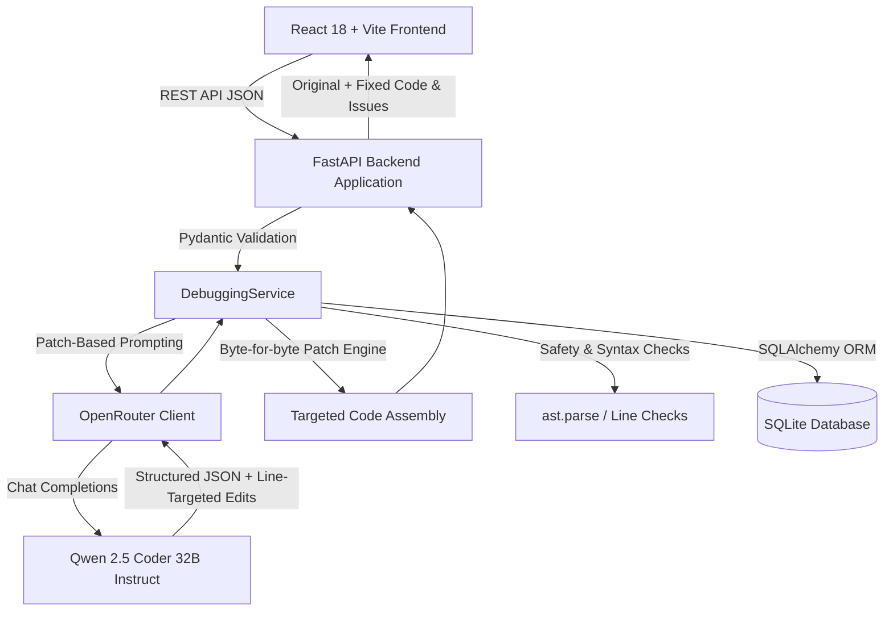

# AI Code Debugger

Full-stack, AI-powered code analysis and automated fix generation web application built with FastAPI, React, TypeScript, Monaco Editor, SQLite, and OpenRouter.

The application allows developers to submit code snippets in Python, Java, C, C++, and JavaScript for multi-category bug detection (Syntax, Logic, Runtime, Code Quality), side-by-side interactive visual diff inspection, one-click patch application, and full session history persistence.

---

## Architecture Overview



- **Frontend**: React 18, TypeScript, Tailwind CSS, Lucide React icons, Monaco Editor & Monaco Diff Editor.
- **Backend**: FastAPI, Pydantic v2, SQLAlchemy 2, SQLite database engine, `httpx` async client.
- **AI Engine**: OpenRouter integration utilizing `qwen/qwen-2.5-coder-32b-instruct` with patch-based line replacement format.

---

## Repository Structure

The actual file tree in this repository:

```text
ai-code-debugger/
├── .env.example              # Template environment configuration
├── .gitignore                # Git exclusions (credentials, databases, venvs, dist)
├── README.md                 # Complete system documentation and guides
├── SPEC.md                   # Full product requirements and technical specifications
├── backend/
│   ├── app/
│   │   ├── api/
│   │   │   ├── __init__.py
│   │   │   ├── dashboard.py  # Dashboard statistics endpoint (/api/dashboard/stats)
│   │   │   ├── debug.py      # Code analysis & debugging endpoint (/api/debug)
│   │   │   ├── health.py     # Service healthcheck endpoint (/api/health)
│   │   │   ├── history.py    # Session history endpoints (/api/history)
│   │   │   └── settings_api.py # Safe model info endpoint (/api/settings/model)
│   │   ├── core/
│   │   │   ├── __init__.py
│   │   │   ├── ai_logging.py # Sanitized AI response logging (never logs API keys)
│   │   │   ├── config.py     # Pydantic Settings and environment configuration
│   │   │   └── exceptions.py # Custom domain exception hierarchy
│   │   ├── models/
│   │   │   ├── __init__.py
│   │   │   └── session.py    # SQLAlchemy DebugSession ORM model
│   │   ├── schemas/
│   │   │   ├── __init__.py
│   │   │   └── debug.py      # Pydantic schemas (IssueItem, ChangeItem, AIAnalysisResult)
│   │   ├── services/
│   │   │   ├── __init__.py
│   │   │   ├── debugging_service.py # Prompt generation, edit extraction, patch engine
│   │   │   └── openrouter_client.py # Async HTTP client for OpenRouter completions
│   │   ├── database.py       # SQLite connection and session management
│   │   └── main.py           # FastAPI entrypoint, middleware, and CORS configuration
│   ├── tests/
│   │   ├── __init__.py
│   │   ├── test_health.py    # Health check and CORS tests
│   │   ├── test_phase2_debug.py # Parsing, patch engine, AST checks, error handling
│   │   └── test_phase4.py    # History, pagination, restart persistence, stats
│   └── requirements.txt      # Backend Python dependencies
└── frontend/
    ├── src/
    │   ├── components/
    │   │   ├── DiffViewer.tsx       # Monaco side-by-side diff comparison
    │   │   ├── IssuesPanel.tsx      # Grouped issue cards with severity badges
    │   │   ├── LanguageSelector.tsx # Supported languages dropdown
    │   │   ├── Navbar.tsx           # Global navigation and status indicator
    │   │   └── Sidebar.tsx          # Application sidebar navigation
    │   ├── data/
    │   │   └── examples.ts          # Sample programs for 5 supported languages
    │   ├── layouts/
    │   │   └── AppLayout.tsx        # Main application layout wrapper
    │   ├── pages/
    │   │   ├── DashboardPage.tsx    # Metrics, language distribution, recent sessions
    │   │   ├── DebuggerPage.tsx     # Primary code debugging and diff workflow
    │   │   ├── DebuggerPage.test.tsx# Debugger page component and workflow tests
    │   │   ├── HistoryPage.tsx      # Searchable, filterable session history table
    │   │   ├── NotFoundPage.tsx     # 404 error page
    │   │   ├── Phase4.test.tsx      # History, Settings, and Stats frontend tests
    │   │   ├── SessionDetailPage.tsx# Read-only detail view of past sessions
    │   │   └── SettingsPage.tsx     # Theme and default language preferences
    │   ├── services/
    │   │   └── api.ts               # Frontend API client methods
    │   ├── types/
    │   │   └── index.ts             # TypeScript interfaces and type definitions
    │   ├── App.tsx                  # Root application router
    │   ├── App.test.tsx             # Application smoke tests
    │   ├── index.css                # Global design system & theme CSS variables
    │   ├── main.tsx                 # React DOM mount entrypoint
    │   ├── setupTests.ts            # Vitest environment setup
    │   └── vite-env.d.ts            # Vite client types
    ├── index.html                   # HTML entrypoint
    ├── package.json                 # Frontend dependencies and npm scripts
    ├── package-lock.json
    ├── postcss.config.js
    ├── tailwind.config.js
    ├── tsconfig.json
    ├── tsconfig.node.json
    └── vite.config.ts               # Vite server, proxy, and build config
```

---

## Prerequisites

- **Python**: Version 3.10+ (tested on Python 3.13)
- **Node.js**: Version 18+ and `npm`
- **OpenRouter API Key**: A valid API key with access to `qwen/qwen-2.5-coder-32b-instruct`.

---

## Installation & Setup

### 1. Clone the Repository
```bash
git clone https://github.com/srimidhuna/ai-code-debugger.git
cd ai-code-debugger
```

### 2. Backend Environment & Dependencies
```bash
cd backend
python -m venv venv

# Windows PowerShell:
.\venv\Scripts\Activate.ps1

# Linux / macOS:
# source venv/bin/activate

pip install -r requirements.txt
cd ..
```

### 3. Frontend Dependencies
```bash
cd frontend
npm install
cd ..
```

### 4. Configure Environment Variables
Copy `.env.example` to `.env` in the repository root:
```bash
cp .env.example .env
```

Edit `.env`:
```ini
OPENROUTER_API_KEY=sk-or-v1-your-actual-api-key-here
OPENROUTER_MODEL=qwen/qwen-2.5-coder-32b-instruct
OPENROUTER_TIMEOUT=60
MAX_SOURCE_BYTES=102400
MAX_SOURCE_LINES=3000
DATABASE_URL=sqlite:///./debugger.db
FRONTEND_ORIGIN=http://localhost:5173
OPENROUTER_PROVIDER_ORDER=Cloudflare
DEBUG_AI_RESPONSES=false
```

### Provider Routing (`OPENROUTER_PROVIDER_ORDER`)
OpenRouter routes completions across multiple host providers. Setting `OPENROUTER_PROVIDER_ORDER=Cloudflare` restricts completion requests strictly to the specified provider with fallbacks disabled. This prevents unexpected schema and formatting variations across different underlying serving endpoints. Leave this variable blank to permit OpenRouter default provider selection.

---

## Running the Application Locally

Run the backend and frontend in two separate terminal sessions:

### Terminal 1: Backend Server
```powershell
cd backend
.\venv\Scripts\uvicorn app.main:app --reload --port 8000
```
Backend API will be available at: `http://localhost:8000` (Swagger docs at `http://localhost:8000/docs`).

### Terminal 2: Frontend Dev Server
```powershell
cd frontend
npm run dev
```
Frontend UI will be accessible at: `http://localhost:5173`.

---

## Running Automated Tests & Builds

### Backend Test Suite (pytest)
```powershell
cd backend
.\venv\Scripts\pytest -v
```
All 77 automated unit and integration tests execute against an isolated in-memory SQLite database and mocked LLM client.

### Frontend Test Suite (Vitest)
```powershell
cd frontend
npm test
```
All 41 unit and smoke tests execute without warnings.

### Frontend Production Build
```powershell
cd frontend
npm run build
```
Generates production bundle in `frontend/dist/`.

---

## Troubleshooting Guide

| Issue / Error | Cause | Resolution |
| :--- | :--- | :--- |
| **HTTP 402 Payment Required** | OpenRouter account has insufficient credit balance. | Top up credits at [OpenRouter Credits](https://openrouter.ai/credits). |
| **HTTP 401 Unauthorized** | Invalid, revoked, or empty `OPENROUTER_API_KEY`. | Verify the key in your `.env` file and test it with a direct curl or OpenRouter dashboard. |
| **HTTP 503 Service Unavailable** | `OPENROUTER_API_KEY` is not configured in `.env`. | Add `OPENROUTER_API_KEY=sk-or-v1-...` to `.env` in the repository root and restart backend. |
| **HTTP 502 Bad Gateway (Provider)** | OpenRouter upstream network failure or unreachable provider. | Check provider routing in `.env` (try clearing `OPENROUTER_PROVIDER_ORDER`). |
| **HTTP 502 (Schema / Validation)** | The AI returned malformed JSON or invalid edit syntax after retry. | Click **Analyze Code** again. Non-deterministic model generations often succeed on re-run. |
| **HTTP 413 Payload Too Large** | Input source code exceeds `MAX_SOURCE_BYTES` (100 KB). | Shorten input code or increase `MAX_SOURCE_BYTES` in `.env`. |
| **HTTP 422 Unprocessable Entity** | Input code exceeds `MAX_SOURCE_LINES` (3000 lines), code is empty, or language is unsupported. | Check input size and ensure language is one of: `python`, `java`, `c`, `cpp`, `javascript`. |
| **Port 8000 Already in Use** | Another process is already running on port 8000. | Terminate the occupying process or run uvicorn on an alternate port: `uvicorn app.main:app --port 8001`. |
| **CORS Error in Browser** | Frontend origin does not match `FRONTEND_ORIGIN` in `.env`. | Ensure `FRONTEND_ORIGIN=http://localhost:5173` in `.env` matches your browser URL. |
| **PowerShell venv Activation Error** | Execution policy prevents running scripts (`Activate.ps1`). | Run `Set-ExecutionPolicy -ExecutionPolicy RemoteSigned -Scope CurrentUser` in PowerShell. |
| **Missing `.env` File** | Backend starts with default fallback settings. | Create `.env` in the project root by copying `.env.example`. |

---

## Sample Programs & Verification Catalog

The application includes pre-loaded sample programs across 5 supported languages:

1. **Python (`find_max.py`)**:
   - **Intended Bug**: Initialises `max_val = 0`, failing on all-negative lists (e.g. `[-3, -1, -4]` returns `0` instead of `-1`).
   - **Expected Fix**: Initialise `max_val = numbers[0]` or `float('-inf')`.
2. **Java (`StringReverser.java`)**:
   - **Intended Bug**: Loop termination condition iterates up to `chars.length`, reversing the string twice and returning the original string.
   - **Expected Fix**: Loop bound changed to `chars.length / 2`.
3. **C (`factorial.c`)**:
   - **Intended Bug**: Initialises `result = 0` and starts loop at `i = 2`, returning `0` for all inputs.
   - **Expected Fix**: Initialise `result = 1` and loop from `1` to `n`.
4. **C++ (`stack.cpp`)**:
   - **Intended Bug**: `pop()` decrements index `items[top--]` without checking `isEmpty()`, causing undefined behaviour on underflow.
   - **Expected Fix**: Add empty check guard before decrementing `top`.
5. **JavaScript (`average.js`)**:
   - **Intended Bug**: Running division `sum += nums[i] / nums.length` inside the loop rather than dividing the accumulated sum outside the loop.
   - **Expected Fix**: Accumulate integer sum inside loop, divide once by length outside.

---

## Security Review Summary

1. **API Key Isolation**:
   - The OpenRouter API key exists **only** in the local `.env` file on your server or development environment.
   - It is never returned in any API responses (e.g. `GET /api/settings/model` returns only `{ "api_key_configured": true }`).
   - The `.gitignore` excludes `.env`, `*.env`, and `.env.local` to prevent accidental commits.
2. **Input Guardrails & Size Limits**:
   - Strict size bounds are enforced by backend validation: requests exceeding `MAX_SOURCE_BYTES` (100 KB) return HTTP 413, and code exceeding `MAX_SOURCE_LINES` (3000 lines) returns HTTP 422.
3. **Zero Untrusted Code Execution**:
   - The backend performs **static analysis and AST parsing only** (`ast.parse` in Python).
   - Code submitted by users or suggested by AI is **never executed or compiled** by the server.
4. **Strict CORS Policy**:
   - CORS is restricted to explicit origins specified in `FRONTEND_ORIGIN` (defaults to `http://localhost:5173`).
5. **Privacy in Database Logging**:
   - Full history of submitted sessions is stored locally in SQLite (`debugger.db`). In shared environments, note that the database contains the submitted source snippets.
   - When `DEBUG_AI_RESPONSES=true` is enabled, raw LLM completions are logged to the console without logging authentication headers.

---

## Known Limitations

1. **Missed Bugs & Hallucinations**:
   - Even with `temperature = 0.0`, the model may fail to detect subtle bugs (such as infinite while loops lacking an increment) or misclassify severity/category (e.g. labeling a reference check as runtime).
2. **Fixes May Change Intended Behaviour**:
   - The AI fix generator may select a syntactically valid but functionally unintended correction (for example, adding bounds checks instead of correcting index arithmetic).
3. **Occasional HTTP 502 on Malformed Model JSON**:
   - If the model omits required JSON punctuation (such as quotes around keys), schema validation will trigger a single bounded retry; if the retry also fails, the backend returns HTTP 502 rather than corrupting the database.
4. **Fixes Are Never Executed or Tested**:
   - Generated fixes are assembled and validated for static structural safety, but are never compiled or executed in a sandbox.
5. **Compiled Language Validation**:
   - While Python code is validated for syntactic soundness via AST parsing (`ast.parse`), Java, C, and C++ code cannot be dynamically compiled by the backend unless external SDKs/toolchains (`javac`, `gcc`) are explicitly installed on the host. The backend enforces structural whitespace and line preservation checks instead.
6. **Decision Finality**:
   - Once a session's fix has been Accepted or Rejected, that decision is locked for that specific history record. Starting a new analysis creates a fresh session.
7. **Client-Side Theme and Default Language Persistence**:
   - User UI preferences (theme mode and default programming language) are persisted in the browser's `localStorage` rather than server-side user profiles.
