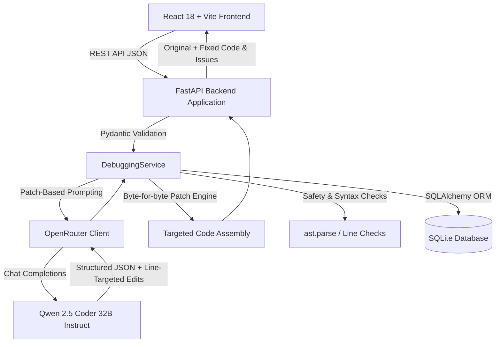

# AI Code Debugger

Full-stack, AI-powered code analysis and automated fix generation web application built with FastAPI, React, TypeScript, Monaco Editor, SQLite, and OpenRouter.

The application allows developers to submit code snippets in Python, Java, C, C++, and JavaScript for multi-category bug detection (Syntax, Logic, Runtime, Code Quality), side-by-side interactive visual diff inspection, one-click patch application, and full session history persistence.

---

## Architecture Overview



- **Frontend**: React 18, TypeScript, Tailwind CSS, Lucide React icons, Monaco Editor & Monaco Diff Editor.
- **Backend**: FastAPI, Pydantic v2, SQLAlchemy 2, SQLite database engine, `httpx` async client.
- **AI Engine**: OpenRouter integration utilizing `qwen/qwen-2.5-coder-32b-instruct` with patch-based line replacement format.

---

## Repository Structure

```text
ai-code-debugger/
├── .env.example              # Template environment configuration
├── .gitignore                # Git exclusions (credentials, databases, venvs, dist)
├── README.md                 # Complete system documentation and guides
├── SPEC.md                   # Full product requirements and technical specifications
├── backend/
│   ├── app/
│   │   ├── api/              # API router endpoints (health, debug, history, settings, stats)
│   │   ├── core/             # Configuration, logging, exception definitions
│   │   ├── models/           # SQLAlchemy database models
│   │   ├── schemas/          # Pydantic request/response schemas
│   │   ├── services/         # DebuggingService and OpenRouterClient
│   │   ├── database.py       # SQLite connection and session management
│   │   └── main.py           # FastAPI entrypoint, middleware, and CORS configuration
│   ├── tests/                # Automated pytest suites (health, patch engine, history, stats)
│   └── requirements.txt      # Backend Python dependencies
└── frontend/
    ├── src/
    │   ├── components/       # Monaco Editor, DiffViewer, IssuesPanel, Sidebar, Navbar
    │   ├── data/             # Sample programs for 5 supported languages
    │   ├── pages/            # Dashboard, Debugger, History, SessionDetail, Settings, NotFound
    │   ├── services/         # API client layer for backend endpoints
    │   ├── types/            # TypeScript data contracts and schemas
    │   └── index.css         # Complete light/dark theme CSS variables and styles
    ├── package.json          # Frontend dependencies and test scripts
    └── vite.config.ts        # Vite build and proxy configuration
```

---

## Prerequisites

- **Python**: Version 3.10+ (tested on Python 3.13)
- **Node.js**: Version 18+ and `npm`
- **OpenRouter API Key**: A valid API key with access to `qwen/qwen-2.5-coder-32b-instruct`.

---

## Installation & Setup

### 1. Clone the Repository
```bash
git clone https://github.com/srimidhuna/ai-code-debugger.git
cd ai-code-debugger
```

### 2. Backend Environment & Dependencies
```bash
cd backend
python -m venv venv

# Windows PowerShell:
.\venv\Scripts\Activate.ps1

# Linux / macOS:
# source venv/bin/activate

pip install -r requirements.txt
cd ..
```

### 3. Frontend Dependencies
```bash
cd frontend
npm install
cd ..
```

### 4. Configure Environment Variables
Copy `.env.example` to `.env` in the repository root:
```bash
cp .env.example .env
```

Edit `.env`:
```ini
OPENROUTER_API_KEY=sk-or-v1-your-actual-api-key-here
OPENROUTER_MODEL=qwen/qwen-2.5-coder-32b-instruct
OPENROUTER_TIMEOUT=60
MAX_SOURCE_BYTES=102400
MAX_SOURCE_LINES=3000
DATABASE_URL=sqlite:///./debugger.db
FRONTEND_ORIGIN=http://localhost:5173
OPENROUTER_PROVIDER_ORDER=Cloudflare
DEBUG_AI_RESPONSES=false
```

---

## Running the Application Locally

Run the backend and frontend in two separate terminal sessions:

### Terminal 1: Backend Server
```powershell
cd backend
.\venv\Scripts\uvicorn app.main:app --reload --port 8000
```
Backend API will be available at: `http://localhost:8000` (Swagger docs at `http://localhost:8000/docs`).

### Terminal 2: Frontend Dev Server
```powershell
cd frontend
npm run dev
```
Frontend UI will be accessible at: `http://localhost:5173`.

---

## Running Automated Tests & Builds

### Backend Test Suite (pytest)
```powershell
cd backend
.\venv\Scripts\pytest -v
```
All 77 automated unit and integration tests execute against an isolated in-memory SQLite database and mocked LLM client.

### Frontend Test Suite (Vitest)
```powershell
cd frontend
npm test
```
All 41 unit and smoke tests execute without warnings.

### Frontend Production Build
```powershell
cd frontend
npm run build
```
Generates production bundle in `frontend/dist/`.

---

## Sample Programs & Verification Catalog

The application includes pre-loaded sample programs across 5 supported languages:

1. **Python (`find_max.py`)**:
   - **Intended Bug**: Initialises `max_val = 0`, failing on all-negative lists (e.g. `[-3, -1, -4]` returns `0` instead of `-1`).
   - **Expected Fix**: Initialise `max_val = numbers[0]` or `float('-inf')`.
2. **Java (`StringReverser.java`)**:
   - **Intended Bug**: Loop termination condition iterates up to `chars.length`, reversing the string twice and returning the original string.
   - **Expected Fix**: Loop bound changed to `chars.length / 2`.
3. **C (`factorial.c`)**:
   - **Intended Bug**: Initialises `result = 0` and starts loop at `i = 2`, returning `0` for all inputs.
   - **Expected Fix**: Initialise `result = 1` and loop from `1` to `n`.
4. **C++ (`stack.cpp`)**:
   - **Intended Bug**: `pop()` decrements index `items[top--]` without checking `isEmpty()`, causing undefined behaviour on underflow.
   - **Expected Fix**: Add empty check guard before decrementing `top`.
5. **JavaScript (`average.js`)**:
   - **Intended Bug**: Running division `sum += nums[i] / nums.length` inside the loop rather than dividing the accumulated sum outside the loop.
   - **Expected Fix**: Accumulate integer sum inside loop, divide once by length outside.

---

## Security Review Summary

1. **API Key Isolation**:
   - The OpenRouter API key exists **only** in the local `.env` file on your server or development environment.
   - It is never returned in any API responses (e.g. `GET /api/settings/model` returns only `{ "api_key_configured": true }`).
   - The `.gitignore` excludes `.env`, `*.env`, and `.env.local` to prevent accidental commits.
2. **Input Guardrails & Size Limits**:
   - Strict size bounds are enforced by FastAPI middleware: requests exceeding `MAX_SOURCE_BYTES` (100 KB) or `MAX_SOURCE_LINES` (3000 lines) are rejected immediately with HTTP 413.
3. **Zero Untrusted Code Execution**:
   - The backend performs **static analysis and AST parsing only** (`ast.parse` in Python).
   - Code submitted by users or suggested by AI is **never executed** by the server.
4. **Strict CORS Policy**:
   - CORS is restricted to explicit origins specified in `FRONTEND_ORIGIN` (defaults to `http://localhost:5173`).
5. **Privacy in Database Logging**:
   - Full history of submitted sessions is stored locally in SQLite (`debugger.db`). When running in production or shared environments, note that the database contains the submitted source snippets.
   - When `DEBUG_AI_RESPONSES=true` is enabled, raw LLM completions are logged to the console without logging authentication headers.

---

## Known Limitations

1. **Model Output Variability**:
   - Even with `temperature = 0.0`, different providers or model revisions of `qwen/qwen-2.5-coder-32b-instruct` may intermittently miss multi-function bugs or misclassify bug categories (e.g. labeling a logic bug as runtime).
2. **Compiled Language Validation**:
   - While Python code is validated for syntactic soundness via AST parsing (`ast.parse`), Java, C, and C++ code cannot be dynamically compiled by the backend unless external SDKs/toolchains (`javac`, `gcc`) are explicitly installed on the host. The backend enforces structural whitespace and line preservation checks instead.
3. **Client-Side Theme and Default Language Persistence**:
   - User UI preferences (theme mode and default programming language) are persisted in the browser's `localStorage` rather than server-side user profiles.
4. **Context Window & Provider Routing**:
   - OpenRouter provider latency can vary. The `.env` provides `OPENROUTER_PROVIDER_ORDER=Cloudflare` to route requests to reliable high-throughput nodes.
